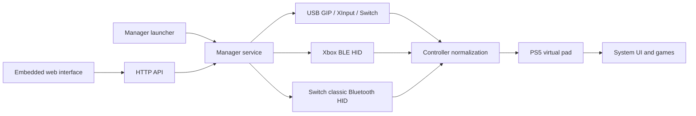

# Architecture and code ownership

The default product is one launcher plus one controller service with runtime
firmware selection for virtual-pad submission.
The launcher embeds the service ELF from `build/ps5-xinput-service.elf`, starts it through the console's existing
ELF loader, opens the manager page, and exits. The service owns controllers
and remains active after the page closes.

## Modules

| Area | Main files | Responsibility |
| --- | --- | --- |
| `src/app/` | `manager_launcher.c`, `manager_service.c`, `manager_http.c` | Service lifetime, controller slots, commands, reconnect policy, web assets and API |
| `src/usb/` | `usb_bridge.c`, `gip.c`, `switch_usb.c` | USB discovery, transfer ownership, protocol initialization, decoding, hotplug and recovery |
| `src/bluetooth/` | `bt_session.c`, `bt_hci.c` | One shared HCI transport, per-link state and input routing; standalone compatibility modes |
| `src/bluetooth/` | `bt_smp.c`, `bt_crypto.c`, `bt_hog.c` | Secure Connections pairing, cryptographic helpers, GATT HID setup |
| `src/bluetooth/` | `bt_classic.c`, `bt_xbox.c`, `bt_advert.c` | Switch classic protocol, verified Xbox HID decoding and discovery parsing |
| `src/bluetooth/` | `bt_store.c`, `bt_timing.c` | Saved bonds/reconnect preferences and independent per-link timing accumulators |
| `src/platform/` | `vpad.c`, `user.c`, `log.c` | Firmware-specific virtual-pad requests, PS5 user lookup and file/UDP logs |
| `testing_tools/src/diagnostics/` | Probe executables, `pad_abi.c`, `assignment.c`, `shell_bind.c` | Investigation tools and explicitly disabled shell-binding experiments |
| `manager/` | `index.html`, `app.css`, `app.js` | Plain browser client; no external framework or remote assets |

The app invokes the USB service and Bluetooth session APIs. Protocol code
normalizes input into the shared GIP-shaped representation; this is an internal
format, not an assertion that Switch or BLE controllers speak GIP on the wire.
`vpad_input` preserves Guide/Home state and translates that representation into
the kernel-facing report. No raw Bluetooth HID report is passed to `/dev/hid`.

`switch_usb.c` retains its existing name because it implements the USB protocol,
but classic Bluetooth reuses its Switch setup/calibration/report helpers. This
shared dependency is intentional; the transport framing lives in `bt_classic.c`.

## Lifetimes and concurrency

- Each USB controller owns its USB device, virtual pad, Guide state and
  recovery counters. Removing one controller does not remove its peers.
- Bluetooth links have independent pairing/profile state, L2CAP reassembly,
  input queues, virtual pads, bonds and timing accumulators.
- Bluetooth links share one radio transport and completion reader. Sessions
  are serviced sequentially; opening a reader per controller would compete
  for the same native USB events.
- The session layer retains a selected-link context while dispatching legacy
  callbacks. It restores that context after peer servicing. HCI callbacks
  queue work; they do not recursively poll the transport.
- Manager control ticks continue servicing ready peers during another link's
  setup. A native DualSense connection request can pause managed Bluetooth
  operation and release shared transfers.
- Normal shutdown removes owned virtual pads and closes owned USB/radio
  resources. It does not reboot the console or patch the shell.

## Firmware boundary

Firmware-specific input submission is isolated in `src/platform/vpad.c`.
The production object reads firmware through the pinned SDK's
`kernel_get_fw_version()` and selects the request and report offsets together.
The provisional rule is <=4.03: ioctl 0x8010482C, 16-byte request, motion offset
0x80; >4.03: ioctl 0x8018482C, 24-byte request, motion offset 0x78. The lower
build/revision bits are excluded from the version comparison. Selection is
cached for the process before report translation and virtual-pad registration;
an unreadable firmware version prevents registration. There is no ioctl probing
or fallback to a different layout after a failed submission.

This threshold does not establish support for every firmware in either range.
The fixed 13.60 implementation and experimental shell hooks remain separately
in `testing_tools/src/platform/vpad_variants.c` for comparison. They are not
compiled or included by the main build.

`make -C testing_tools manager-1360` compiles a separate virtual-pad object, service, embedded
blob and launcher. This keeps profiles from accidentally sharing an embedded
service. The user reported a successful USB Xbox test on that variant.

## Build organization

The top-level `Makefile` has one product: `dist/ps5-xinput-manager.elf`.
It includes only `mk/config.mk` (SDK, production headers and required crypto)
and `mk/manager.mk` (service, embedded web assets and launcher).
The service ELF stays in `build/`; release `dist/` contains only the manager
ELF, its checksum and the ZIP.

The main include paths contain only `src/app`, `src/platform`, `src/usb` and
`src/bluetooth`. No production header, source, library or package input comes
from `testing_tools`. The main build works with that directory absent.

`testing_tools/Makefile` is an explicit opt-in entry point. Its grouped rules
build tests, standalone payloads, alternate firmware and probes into
`testing_tools/build` and `testing_tools/dist`. It may consume production
sources for tests; the production build never consumes development sources.
Legacy USB/Bluetooth entry points and feature switches were preserved there
before inactive standalone/probe branches were removed from the main sources.

## Validation and maintenance

Run `make -C testing_tools host-test` after changing source paths, packet handling, mappings or
ownership. Simulations cover four USB devices, four Xbox BLE links, mixed
three-Xbox-plus-Switch links, input during setup, busy retries and cleanup.
`testing_tools/tests/bt_timing.c` separately checks timing boundaries and per-link isolation.
Two integration tests intentionally include implementation C files to replace
platform operations with host fakes; their paths must follow source moves.

Host tests cannot establish physical radio reliability, console UI delivery,
or end-to-end input latency. See the live-test records for those limits.

The 2026-10-15 cleanup moved the former `src/main.c` to
`src/usb/usb_bridge.c`, and `src/bt_pair.c` to
`src/bluetooth/bt_session.c`. Other files keep their basenames within the new
module folders. Earlier README investigation notes are preserved under
`testing_tools/docs/history/implementation-notes.md`; vendored code and licenses were not
reformatted or replaced.
